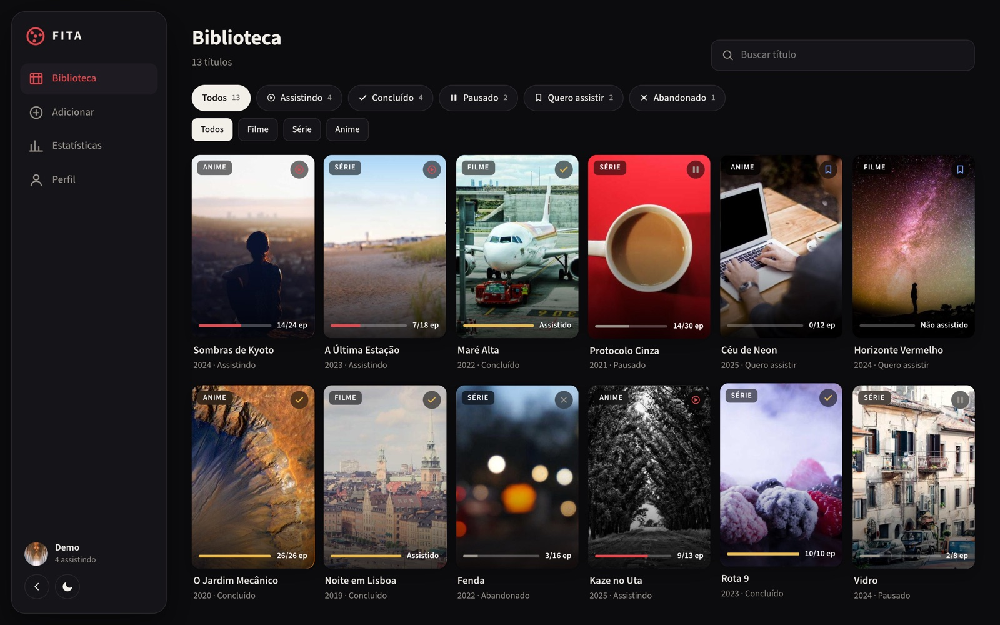
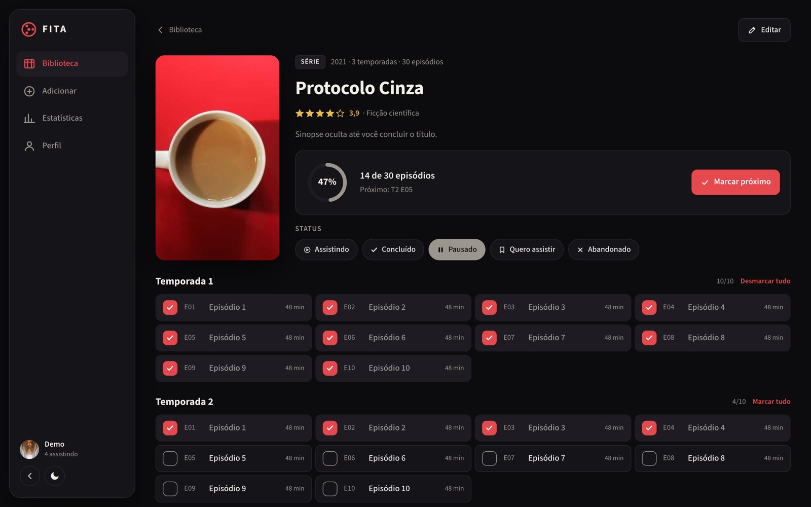
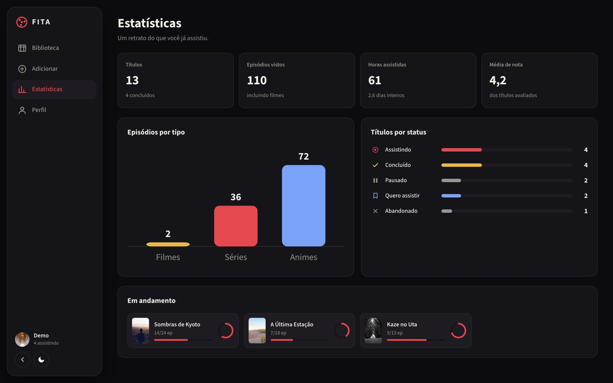

# Fita

O Fita guarda tudo o que você assiste num lugar só. Filmes, séries e animes ficam numa biblioteca pessoal, com o progresso marcado episódio por episódio, para nunca mais precisar lembrar onde parou.

O visual veio do design "Fita", criado no Claude Design.

## Funcionalidades

Cada título entra na biblioteca com tipo, status, ano, gêneros, capa e sinopse. Séries e animes podem ter quantas temporadas quiser, cada uma com seu próprio número de episódios, e tudo isso pode ser editado depois sem perder o que já foi assistido.

Na página do título, os episódios aparecem agrupados por temporada. Um clique marca ou desmarca um episódio, dá para marcar a temporada inteira de uma vez e o botão "Marcar próximo" avança para o episódio seguinte. O próximo da fila fica destacado e a página rola até ele.

O status acompanha o progresso. Marcar o primeiro episódio de algo que estava em "Quero assistir" passa o título para "Assistindo", e marcar o último o conclui. Pausado e Abandonado só mudam quando você muda. Cada título também pode receber uma nota de 1 a 5 estrelas.

A biblioteca tem busca por nome e filtros por status e por tipo, que ficam na URL e podem ser compartilhados ou salvos nos favoritos. A tela de estatísticas mostra títulos concluídos, episódios vistos, horas assistidas, média das notas e o que está em andamento.

No perfil ficam o tema claro ou escuro, a opção de esconder a sinopse até concluir o título, o destaque do próximo episódio e a exportação da biblioteca em JSON.

Para entrar, basta criar uma conta com e-mail e senha ou testar como convidado, sem cadastro. A interface funciona no computador e no celular, com navegação inferior em telas pequenas.

## Prévia







## Estrutura

```
apps/api         Bun + Elysia, better-auth, Drizzle (Postgres), OpenAPI em /docs
apps/web         React + Vite, Tailwind v4, shadcn/ui, React Router, React Query, RHF + Zod, Zustand
packages/shared  Schemas Zod, constantes e regras de progresso usadas pelos dois lados
```

## Rodando

```bash
bun install
bun run db:up                           # Postgres em 127.0.0.1:5436
cp apps/api/.env.example apps/api/.env  # e troque o BETTER_AUTH_SECRET
bun run db:migrate
bun run db:seed                         # opcional: conta demo@fita.dev / Senha1234 com 12 títulos
bun run dev                             # API em :3333, web em :5173
```

O Vite encaminha `/api` para a API, então front e API ficam na mesma origem e o cookie de sessão funciona sem configuração extra.

## Scripts

| Comando | O que faz |
| --- | --- |
| `bun run test` | Testes de todos os pacotes (bun test na API e no shared, Vitest no web) |
| `bun run typecheck` | `tsc --noEmit` em todos os pacotes |
| `bun --filter @fita/api db:generate` | Gera migration a partir do schema Drizzle |
| `bun --filter @fita/api db:studio` | Abre o Drizzle Studio |

## API

A API roda em Bun com Elysia e guarda os dados no Postgres por meio do Drizzle. Ela cuida da biblioteca de cada usuário: cadastro e edição de títulos, marcação de episódios e temporadas, preferências, estatísticas e exportação em JSON.

A autenticação usa o better-auth, com login por e-mail e senha ou como convidado. Fora `/health` e `/api/auth`, todas as rotas exigem sessão.

Os dados de entrada são validados com os mesmos schemas Zod que o frontend usa, vindos de `packages/shared`. A documentação OpenAPI gerada a partir deles fica em http://localhost:3333/docs, com todas as rotas e formatos.

## Temporadas e progresso

Cada título guarda `episodes`, a quantidade de episódios de cada temporada (ex.: `[12, 13, 10]`), e `watched`, os episódios vistos por temporada (ex.: `[[1, 2, 3], [], []]`). Assim, editar uma temporada não desloca o progresso das outras. Ao reduzir ou remover temporadas, o progresso do que deixou de existir é descartado, e o formulário de edição avisa quantos episódios serão desmarcados.

As regras ficam em `packages/shared/src/progress.ts`. Marcar o último episódio conclui o título; desmarcar algo de um título concluído volta para Assistindo; marcar um episódio de algo em Quero assistir também passa para Assistindo. Pausado e Abandonado não mudam sozinhos. Filme é tratado como uma temporada com um episódio.
